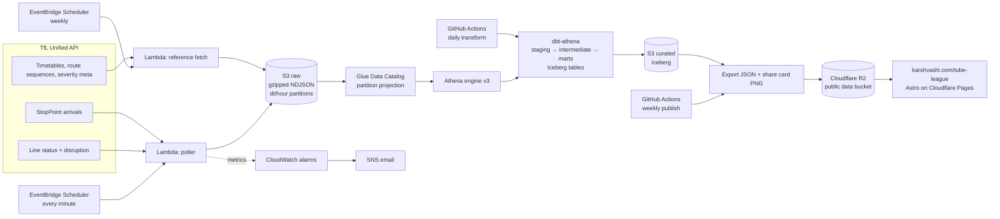

# mind-the-data: Tube League Table build plan

Status: approved for build, 2026-11-01
Owner: Karsh Vashi

This is the engineering plan for the Tube League Table, a weekly reliability ranking of London rail lines built from TfL's live data. It turns the project brief into an architecture, a data model, metric specifications and a sequence of milestones, each with acceptance criteria that can be checked by running a command.

Milestone status is tracked in the checklist at the end of each milestone. Tick items only when the acceptance check passes.

---

## 1. Goals and non-goals

### Goals

1. Capture TfL line status, disruptions and arrival predictions continuously from the first week, because none of it can be backfilled.
2. Publish a weekly league table that ranks every line two ways: declared status (Disruption Index) and measured service (Experienced Reliability), with the Honesty Gap between them as the headline.
3. Run for under £5 a month, unattended, with alerts when collection breaks.
4. Make every number reproducible: raw data kept, transformations versioned, methodology published.

### Non-goals (for v1)

- A live API or real-time dashboard. The website reads static JSON regenerated weekly.
- Train-level tracking. Gaps are measured at chosen platforms from successive arrivals.
- National Rail data, passenger weighting, cause classification and the "Leave Now" / "Should I Run?" extensions. These are phase 2 or later.

---

## 2. Architecture



### Flow in one paragraph

A Lambda runs every minute, calls TfL for line status, disruptions and arrivals at a fixed set of measurement stations, and writes each response as one gzipped NDJSON object to S3, partitioned by feed, date and hour. A second Lambda fetches slowly changing reference data weekly. Glue tables with partition projection expose the raw files to Athena without crawlers. A daily GitHub Actions job runs `dbt build` on Athena, which turns raw snapshots into Iceberg tables: status intervals, inferred train arrivals, headways, and weekly line scores. Every Monday a second job exports the league as JSON, renders a share card image, uploads both to Cloudflare R2 and triggers a rebuild of the website.

### Region and accounts

- AWS region: `eu-west-2` (London).
- One AWS account, one environment (`prod`) for infrastructure. dbt has `dev` and `prod` targets that write to separate Glue databases, both reading the same raw bucket.
- Lambdas are not in a VPC. No NAT gateway, ever (it would cost more than everything else combined).

---

## 3. Stack and decisions

Each decision has a short ADR in `docs/adr/`. Summary:

| Area | Choice | Why | Alternatives considered |
|---|---|---|---|
| Language | Python 3.12, `uv` for env and lockfile | One language for ingest, tests and publishing; fast reproducible installs | Poetry (slower), pip-tools |
| Ingestion compute | AWS Lambda (arm64) on EventBridge Scheduler, 1-minute rate | Workload is ~5 s of I/O per minute; fits Lambda's always-free allowance; no servers to patch | ECS Fargate always-on task (needed only if 30 s polling is required, see ADR-002), Glue Python shell (no benefit) |
| HTTP | `httpx` async with bounded concurrency, retries with backoff and jitter | ~50 calls per minute must finish in seconds | `requests` + threads |
| Payload contracts | Pydantic v2 models for each TfL response | Fails loudly if TfL changes shape; models double as documentation | Unvalidated dicts |
| Raw storage | S3, gzipped NDJSON, one object per feed per poll, Hive-style partitions | Lossless, replayable, cheap; raw is irreplaceable so it is kept indefinitely | Firehose to Iceberg (adds cost and hides the raw payload), DynamoDB |
| Catalog | Glue Data Catalog with partition projection on raw | No crawler cost or lag; partitions resolve from the path | Glue crawlers |
| Query engine | Athena engine v3 | Serverless, pay per scan, native Iceberg MERGE; data volume is tens of GB | Snowflake (credit minimums for a tiny workload), DuckDB/MotherDuck (equally viable technically; Athena keeps compute next to the data with IAM-only access) |
| Table format | Apache Iceberg for all curated tables | MERGE for idempotent incrementals, schema evolution, time travel for debugging, OPTIMIZE/VACUUM for small files | Hive Parquet tables with insert_overwrite |
| Transformation | dbt Core with `dbt-athena-community` | Tested, documented, lineage-tracked SQL; unit tests for metric logic | Hand-written Athena SQL in Step Functions |
| Data quality | dbt generic and singular tests, dbt unit tests, source freshness; a weekly completeness model | Quality checks live with the models they guard | Great Expectations (heavier for this size) |
| Orchestration | GitHub Actions cron: daily `dbt build`, weekly publish; OIDC role into AWS | Free for public repos, runs are visible and re-runnable, no orchestrator to host | MWAA (hundreds of pounds a month), Step Functions (fine, but a second deployment surface), Dagster+ (paid hosting) |
| Infrastructure | Terraform, S3 backend with native lockfile, modules per concern | Everything reproducible from the repo | CDK |
| CI/CD | GitHub Actions: lint, types, tests, `dbt parse`, `terraform validate` and `plan` on every PR; `terraform apply` on merge to `main` behind a protected `production` environment that requires manual approval | Infra changes are reviewed as plans before they apply | Applying from a laptop |
| Secrets | TfL app key in SSM Parameter Store (SecureString, standard tier) | Free; Lambda reads it at cold start | Secrets Manager ($0.40 a month per secret, no extra value here) |
| Monitoring | CloudWatch alarms: poller errors, poller not writing for 10 minutes, Lambda throttles; SNS email | Silent data loss is the main risk | Third-party monitoring |
| Publishing | Static JSON + PNG to Cloudflare R2, website rebuild via Cloudflare Pages deploy hook | The site is already on Cloudflare Pages; R2 egress is free | S3 + CloudFront, committing data into the website repo |
| Share card | HTML template rendered to PNG with Playwright (Chromium) | Tube colours and typography are easier in HTML/CSS than matplotlib | matplotlib, Pillow |
| Tooling | `ruff` (lint + format), `mypy --strict` on `src/`, `pytest`, `sqlfluff` (Athena dialect, dbt templater), `pre-commit`, `tflint` | Fast, standard, enforced in CI | |

---

## 4. Repository layout

```
mind-the-data/
├── README.md
├── Makefile                      # single entry point for every check and task
├── pyproject.toml / uv.lock
├── .pre-commit-config.yaml
├── config/
│   ├── lines.yaml                # line ids in scope, display names, colours, division seeding
│   └── stations.yaml             # measurement stations per line (NaPTAN ids, platforms/directions)
├── src/mind_the_data/
│   ├── common/                   # settings, logging, S3 writer, time helpers
│   ├── ingest/
│   │   ├── client.py             # async TfL client: retries, rate limiting, app key
│   │   ├── models.py             # Pydantic models for status, disruption, arrival, timetable, route
│   │   ├── poller.py             # Lambda handler: per-minute poll
│   │   └── reference.py          # Lambda handler: weekly reference fetch
│   └── publish/
│       ├── export.py             # query marts, write versioned JSON matching the contract
│       ├── share_card.py         # render PNG from HTML template
│       ├── templates/
│       └── contract/             # JSON Schemas for every published file
├── transform/                    # dbt project
│   ├── dbt_project.yml / profiles.yml (env-driven) / packages.yml
│   ├── models/{staging,intermediate,marts}/
│   ├── seeds/                    # severity weights, time bands, line operating hours, strike weeks
│   ├── macros/
│   ├── tests/                    # singular tests
│   └── analyses/                 # data-quality investigation queries
├── infra/
│   ├── modules/{raw_bucket,curated_bucket,poller,reference,catalog,alarms,ci_role}/
│   └── envs/prod/
├── tests/
│   ├── fixtures/tfl/             # recorded real responses, scrubbed of the app key
│   ├── unit/
│   └── integration/              # moto-based S3 tests
├── docs/
│   ├── PLAN.md
│   ├── adr/
│   ├── architecture.md
│   ├── methodology.md            # becomes the public methodology page
│   ├── data-quality/             # dated findings from data-quality reviews
│   └── runbook.md
└── .github/workflows/
    ├── ci.yml
    ├── infra.yml                 # plan on PR, apply on main with approval
    ├── transform-daily.yml
    └── publish-weekly.yml
```

`make check` runs: `ruff check`, `ruff format --check`, `mypy`, `pytest`, `sqlfluff lint transform/models`, `dbt parse`, `terraform fmt -check -recursive`, `terraform validate`, `tflint`. `make check-fast` runs ruff, mypy and unit tests only.

---

## 5. Data collection specification

### 5.1 Feeds

| Feed | Endpoint | Cadence | Raw prefix |
|---|---|---|---|
| Line status | `Line/Mode/tube,elizabeth-line,dlr,overground,tram/Status` | every minute | `raw/line_status/` |
| Line disruption | `Line/Mode/{same modes}/Disruption` | every minute | `raw/line_disruption/` |
| Arrivals | `StopPoint/{naptanId}/Arrivals` for each measurement station | every minute | `raw/arrivals/` |
| Stop disruption | `StopPoint/Mode/{modes}/Disruption` | every 5 minutes | `raw/stop_disruption/` |
| Route sequence | `Line/{id}/Route/Sequence/{inbound,outbound}` | weekly | `raw/ref_route_sequence/` |
| Timetable | `Line/{id}/Timetable/{stopPointId}` for each measurement station | weekly | `raw/ref_timetable/` |
| Severity meta | `Line/Meta/Severity` | weekly | `raw/ref_severity/` |

Object key pattern: `raw/{feed}/dt=YYYY-MM-DD/hour=HH/{feed}_{poll_ts_utc}_{uuid}.ndjson.gz`.

Each NDJSON line is an envelope:

```json
{"poll_id": "uuid", "polled_at": "2026-11-08T08:15:00.123Z", "feed": "arrivals",
 "request": {"path": "/StopPoint/940GZZLUOXC/Arrivals"}, "http_status": 200,
 "latency_ms": 184, "payload": [ ... TfL response unchanged ... ]}
```

Failed requests are written too, with `http_status` and an empty payload, so missing data is distinguishable from no disruption.

### 5.2 Measurement stations

`config/stations.yaml` holds 3 to 5 platforms per line: busy core stations plus branch ends. Interchanges serve several lines from one call, so the expected total is about 50 stations. Selection is done in M1 from route sequences, with each choice justified in a comment (core, branch, terminus).

### 5.3 Rate limits and budget

About 52 calls a minute against a 500 per minute registered-key limit. The client caps concurrency at 10 and stops a poll cleanly if it passes 45 seconds, so polls never overlap. All times are stored in UTC; London-time conversions happen in dbt.

### 5.4 Polling interval (ADR-002)

v1 polls arrivals every 60 seconds. An arrival is inferred from the last prediction seen before a train leaves the board, so its timestamp comes from TfL's `expectedArrival`, not from the poll time. The week-one data-quality review measures how far predictions move in their final minute. If error exceeds ±45 seconds for most lines, arrivals move to a 30-second loop on an always-on Fargate Spot task (about £3 to £4 a month extra).

---

## 6. Data model

### 6.1 Layers

| Layer | Materialisation | Contents |
|---|---|---|
| Sources | Glue external tables over raw JSON | one table per feed, `payload` as JSON string, partition projection on `dt`/`hour` |
| Staging (`stg_`) | Iceberg, incremental append, partitioned by day | flattened, typed, deduplicated rows, one model per feed |
| Intermediate (`int_`) | Iceberg, incremental merge | business logic: status per line per minute, status intervals, inferred arrivals, headways, scheduled headways |
| Marts (`fct_`, `dim_`, `rpt_`) | Iceberg tables | daily and weekly line scores, league tables, divisions, seasons, published views |

### 6.2 Key models

| Model | Grain | Notes |
|---|---|---|
| `stg_line_status` | poll x line x status entry | a line can carry several statuses at once; keep them all here |
| `stg_arrivals` | poll x prediction | `naptan_id`, `line_id`, `platform_name`, `direction`, `vehicle_id`, `expected_arrival`, `time_to_station`, `prediction_id` |
| `int_line_minute_status` | line x minute | worst-status-wins (lowest severity among statuses whose validity covers the minute); `is_missing` when no successful poll in that minute |
| `int_status_intervals` | line x continuous status run | start, end, severity, reason text, planned/unplanned flag |
| `int_incidents` | line x unplanned disruption | an incident starts when a line leaves Good Service for an unplanned severity and ends when it returns; gaps under 5 minutes merge |
| `int_inferred_arrivals` | platform x train arrival | see 7.2 |
| `int_headways` | platform x consecutive arrival pair | gap in seconds, hour band, day type |
| `int_scheduled_headways` | line x station x direction x day type x hour | from timetable reference data; seed fallback `seed_line_frequencies` |
| `dim_lines` | line | from `config/lines.yaml` via seed |
| `dim_service_hours` | line x date x time band | scheduled operating minutes for normalisation |
| `fct_line_daily` | line x date | every metric at daily grain plus completeness |
| `fct_line_weekly` | line x ISO week (Mon to Sun, London time) | every metric, ranks, movement vs previous week |
| `rpt_league_weekly` | line x week | the published table |
| `rpt_divisions_monthly` | line x month | division membership, promotion and relegation |
| `rpt_season` | line x season (April to March) | cumulative standings |
| `rpt_engineering_works` | line x month | planned closure hours |
| `rpt_monday_morning` | line x week | weekday 07:00 to 10:00 only |

---

## 7. Metric specifications

All metrics are computed over **scheduled service minutes**, never raw time. Minutes flagged `is_missing` are excluded from both numerator and denominator, and completeness is reported beside every score.

### 7.1 Declared view: Disruption Index

```
Disruption Index = 100 x Σ_minutes ( w_severity(worst status in minute) x w_time(minute) ) / scheduled service hours
```

Severity weights (`seeds/severity_weights.csv`): Good Service 0, Minor Delays 1, Reduced Service 1.5, Severe Delays 3, Part Suspended 5, Suspended 8, Planned Closure 0, Part Closure 0, Special Service 1, Bus Service 0 when planned, otherwise 5. Unknown codes fail a dbt test rather than defaulting silently.

Time weights (`seeds/time_bands.csv`, Europe/London): weekday 07:00 to 10:00 and 16:00 to 19:00 = 2; other weekday service = 1; weekends and Night Tube = 0.75.

Supporting stats: Good Service % (share of service minutes at severity 10), incidents per 100 service hours, median recovery minutes.

Planned Closure and Part Closure minutes are excluded from the reliability score and reported in `rpt_engineering_works`.

### 7.2 Measured view: inferred arrivals

For each platform and direction, per poll, the board shows predictions. Inference rule (implemented in SQL with a Python reference implementation used as the test oracle):

1. Group predictions into trains: same `vehicle_id` where it is stable; otherwise cluster predictions whose `expected_arrival` values sit within 45 seconds of each other across consecutive polls. Collapse duplicate predictions with different ids but near-identical `expected_arrival` (a known TfL quirk).
2. A train is considered to have arrived when it is on the board in poll *t* with `time_to_station` ≤ 120 seconds and absent in poll *t+1*, or shows `time_to_station` = 0.
3. Inferred arrival time = the last `expected_arrival` observed for that train.
4. Discard trains seen in only one poll with `time_to_station` > 120 (phantoms).

Quality gate: inferred trains per hour must fall between 80% and 120% of scheduled trains per hour for the line-hour to count. Line-hours outside the band are flagged and excluded from Experienced Reliability.

### 7.3 Measured view: Experienced Reliability

- **Headway**: time between consecutive inferred arrivals at a platform and direction.
- **Scheduled headway**: from `int_scheduled_headways` for that line, station, direction, day type and hour.
- **Excess wait** (per platform-direction-hour, then averaged per line and week weighted by service hours): actual average wait minus scheduled average wait, assuming passengers arrive at random. Actual average wait = `Σ h² / (2 x Σ h)` over observed headways `h` in the hour; scheduled average wait = `H / 2` where `H` is the scheduled headway (or `Σ H² / (2 x Σ H)` when the timetable gives uneven gaps). Negative values are kept, not clipped, so a line running better than timetable is visible. Reported in minutes.
- **Long gaps**: count of headways greater than 2 x scheduled headway, per 100 service hours.
- **Honesty Gap**: hours in which the line's worst declared status was Good Service for the whole hour and at least one measurement platform recorded a long gap. Reported as hours per week and as a share of Good Service hours.

Experienced Reliability rank = rank by excess wait, ties broken by long gaps. Once validated (M4 acceptance), it leads the published table and the Disruption Index sits beside it.

### 7.4 Fairness rules

| Issue | Rule |
|---|---|
| Line size | normalise per scheduled service hour |
| Engineering works | excluded from reliability, shown in their own table |
| Several statuses at once | worst-status-wins per minute (ADR-004) |
| Part suspensions vary in size | flat weight in v1; affected-section scaling in phase 2 |
| Strikes | kept in; weeks tagged from `seeds/industrial_action.csv`; a "strikes excluded" variant is exported |
| Poller gaps | missing, never Good Service; completeness shown per line-week; a line-week under 90% completeness is marked provisional |
| Short disruptions | resolution is one minute, stated in the methodology |
| Low-volume lines (Trams, Liberty) | shown, flagged as low volume |

### 7.5 Validation

- Sensitivity: rerun weekly ranks under three alternative weight sets; report Spearman correlation and whether the top and bottom three change.
- External: once three 4-week periods exist, compare line ranking with TfL's published share of scheduled trips operated; report rank correlation in the methodology.

---

## 8. Published outputs and contract

`publish/contract/*.schema.json` defines every file. The website only reads these.

```
league/latest.json
league/{iso_week}.json          # e.g. 2026-W48
lines/{line_id}.json            # history, worst week, typical bad hours
divisions/{yyyy-mm}.json
season/{season}.json
meta/methodology.json           # weights, thresholds, completeness, generated_at, git sha
cards/{iso_week}.png            # 1200x675 for LinkedIn and X; also 1080x1350 variant
open-data/{yyyy-mm}/*.parquet   # monthly open dataset (M7)
```

Every JSON file carries `schema_version`, `generated_at`, `data_window`, `completeness` and `git_sha`.

---

## 9. Human steps and what they unblock

Some steps need a person: account security, secrets, approvals and anything that spends money. They are tracked here so the build never waits on them silently. Work that does not depend on an open step goes ahead; work that does is built and tested offline, and its PR says `Blocked on H<n>`.

| Id | Step | Needed before | Status |
|---|---|---|---|
| H1 | Local tools: `gh auth login`, `uv`, `terraform` 1.10+, `tflint`, `jq`, AWS CLI v2 | M0 | [ ] |
| H2 | Repo set up: `bash local-setup/install.sh`, git name and noreply email | M0 | [x] |
| H3 | AWS account security: root MFA on, no root access keys, `mtd-admin` IAM user with MFA (profile `mtd-admin`) | M0 bootstrap | [ ] |
| H4 | Dev identity: `wiki-lake-user` re-scoped to `ReadOnlyAccess` (profile `mtd-dev`); local sessions start with `AWS_PROFILE=mtd-dev` | first read of real AWS state (M1 deploy check) | [ ] |
| H5 | AWS Budget: £5 a month with alerts at 50%, 80%, 100% | M1 deploy | [ ] |
| H6 | Run the bootstrap once as `mtd-admin` (state bucket, GitHub OIDC provider, CI role), following `docs/runbook.md`; then set repo variable `AWS_ROLE_ARN` | `infra.yml` plan/apply | [ ] |
| H7 | GitHub: `production` environment with you as required reviewer; squash merge only | first `terraform apply` | [ ] |
| H8 | TfL app key registered and stored in SSM at `/mind-the-data/tfl/app_key` (command in `docs/runbook.md`) | M1 deploy | [ ] |
| H9 | GitHub ruleset on `main`: PR required, `ci` check required, no force push or deletion | after the first green CI run | [ ] |
| H10 | Approve the `production` run of `infra.yml` that deploys the collector | M1 deploy | [ ] |
| H11 | Attach the Athena/Glue/results-bucket inline policy to `mtd-dev` (policy JSON produced in M2) | M2 dbt runs against `dev` | [ ] |
| H12 | Cloudflare: R2 bucket, API token, Pages deploy hook; add as GitHub secrets | M5 publish | [ ] |

Order of work while steps are open:

- Without H3 to H8: all of M0 except the bootstrap apply, and all of M1's code, tests, Terraform and workflows. Fixtures are recorded from the TfL API without a key (anonymous limit 50 requests a minute).
- The critical path is H3, H6, H7, H8, H10: every day before the collector is deployed is a day of data that cannot be recovered.

## 10. Milestones

Each milestone ends with an acceptance check that can be run, a PR per task (small PRs, under ~400 changed lines where possible), and an updated status checklist.

### M0. Foundations (target: days 1 to 2)

Tasks
- [x] Repo scaffold per section 4; `uv` project; `Makefile` with `check`, `check-fast`, `test`, `fmt`, `dbt-build-dev`, `plan`.
- [ ] Pre-commit hooks, ruff, mypy strict on `src/`, pytest, sqlfluff config, tflint.
- [ ] `ci.yml` running `make check` on every PR.
- [ ] `infra/bootstrap/`: Terraform with local state that creates the remote state bucket (versioned, encrypted, S3 native lockfile), the GitHub OIDC provider and the CI role (trust limited to this repo's `main` branch and `production` environment; separate read-only trust for pull requests). Applied once by a human (H6). Outputs the role ARN.
- [ ] `infra/envs/prod/` backend config pointing at the bootstrap state bucket; `ci_role` permissions scoped to the resources this project creates.
- [ ] `infra.yml`: `terraform plan` on PRs and `apply` on `main` behind the `production` environment. Both jobs are skipped with a notice when the repo variable `AWS_ROLE_ARN` is not set, so CI stays green before H6.
- [ ] `docs/runbook.md` with exact commands for every human step in section 9 that needs a terminal (H6, H8), including the SSM `put-parameter` command for the TfL key.
- [ ] `.env.example` listing every environment variable the code reads (`TFL_APP_KEY` optional locally, `AWS_PROFILE`, dbt target settings); `.env` is gitignored.
- [ ] ADR-001 (stack), ADR-002 (polling interval), ADR-003 (raw format), ADR-004 (multiple statuses).

Acceptance
- `make check` exits 0 locally and in CI on a PR.
- `terraform -chdir=infra/bootstrap validate` and `terraform -chdir=infra/envs/prod validate` pass.
- After H6: `terraform plan` in CI shows only expected resources.

### M1. Collector live (target: by end of week 1, highest priority)

Tasks
- [ ] Pydantic models for status, disruption, arrival, timetable, route sequence, severity; unit tests against recorded fixtures (record once from the live API with `scripts/record_fixtures.py`, which works without a key at the anonymous limit and strips any key from saved URLs).
- [ ] Async TfL client with retries, backoff, jitter and a 45-second poll budget. Key resolution: SSM parameter in Lambda, `TFL_APP_KEY` env var locally, anonymous if neither (logged as a warning).
- [ ] `config/lines.yaml` with every line id verified against `Line/Mode/{modes}` output, and `config/stations.yaml` with 3 to 5 measurement stations per line chosen from route sequences.
- [ ] Poller Lambda and reference Lambda; S3 writer producing the key pattern in 5.1; envelope includes failures.
- [ ] Terraform: raw bucket (versioning off, SSE-S3, public access blocked, lifecycle to Intelligent-Tiering after 30 days), Lambdas (arm64, 512 MB, 60 s timeout, reserved concurrency 1 for the poller), EventBridge schedules, IAM least privilege, log retention 14 days.
- [ ] Alarms: poller error rate, no objects written for 10 minutes (custom metric emitted per successful write), throttles. SNS email subscription.
- [ ] Integration tests with moto for the S3 writer and handler.

Acceptance (offline, before H3 to H8)
- `make check` exits 0, including handler tests against recorded fixtures and moto S3.
- `uv run python -m mind_the_data.ingest.poller --local --out ./tmp` performs one real poll without AWS and writes correctly partitioned files locally.
- `terraform validate` passes for the collector modules.

Acceptance (deployed, after H6, H7, H8, H10)
- A script `scripts/completeness.py --hours 24` reports at least 99% of minutes with a successful status poll and at least 97% for arrivals.
- Disabling the TfL key in a test invocation fires the error alarm (documented in the runbook).

### M2. Raw catalog and week-one data review (target: week 2)

Tasks
- [ ] Glue database and external tables for each raw feed with partition projection (Terraform).
- [ ] dbt project skeleton: profiles from env vars, `dev`/`prod` targets, sources with freshness (warn 15 min, error 60 min on status and arrivals).
- [ ] Staging models for every feed with uniqueness and not-null tests.
- [ ] `scripts/athena_query.py`: run a read-only query against the `dev` workgroup, print results and bytes scanned, refuse anything that is not a SELECT/WITH/SHOW/DESCRIBE.
- [ ] `transform-daily.yml`: daily 03:30 Europe/London `dbt build --target prod`, using the OIDC role.
- [ ] Data-quality review written to `docs/data-quality/YYYY-MM-DD-week-one.md`, answering: which severity codes appear on line status; whether `vehicle_id` is stable per train per line; how often duplicate predictions appear; how much `expected_arrival` moves in the last 120 seconds; which measurement stations return empty or odd boards; arrivals coverage for Overground, DLR and Trams.

Acceptance
- `dbt build --target dev` exits 0 with all tests passing.
- `dbt source freshness` passes.
- The data-quality document exists and states a decision on ADR-002 (keep 60 seconds or move to 30).

### M3. Declared view: Disruption Index league (target: week 2 to 3)

Tasks
- [ ] Seeds: severity weights, time bands, line operating hours (v1 fixed hours per line and day type, documented with sources).
- [ ] `int_line_minute_status`, `int_status_intervals`, `int_incidents`, `dim_service_hours`.
- [ ] `fct_line_daily`, `fct_line_weekly` with Disruption Index, Good Service %, incidents, recovery, completeness.
- [ ] dbt unit tests with hand-computed expected values for: overlapping statuses, a planned closure, a poller gap, a peak-hour delay, a disruption spanning midnight, a week boundary in London time (including the late-March and late-October clock changes).

Acceptance
- `dbt build --target dev --select +fct_line_weekly` exits 0, all unit tests pass.
- `analyses/league_preview.sql` returns one row per in-scope line for the latest complete week.

### M4. Measured view: Experienced Reliability and the Honesty Gap (target: weeks 3 to 4)

Tasks
- [ ] Python reference implementation of arrival inference in `src/mind_the_data/analysis/arrivals.py` with property-based tests (Hypothesis) on synthetic boards.
- [ ] `int_inferred_arrivals` in SQL; a test that runs both implementations on the same fixture day and asserts identical arrivals.
- [ ] Timetable parser: `int_scheduled_headways` from reference timetables; fallback seed `seed_line_frequencies` for lines where the timetable is unusable, each flagged.
- [ ] `int_headways`, excess wait, long gaps, Honesty Gap in `fct_line_weekly`.
- [ ] Quality gate from 7.2 as a model plus a test that fails if more than 30% of core-station line-hours fall outside 80% to 120%.

Acceptance
- `dbt build --target dev` exits 0.
- For at least 3 full days of data, inferred trains per hour sit within 80% to 120% of scheduled for at least 80% of core-station line-hours on Tube lines. The result and any excluded lines are recorded in `docs/data-quality/`.

### M5. Publish pipeline (target: week 4)

Tasks
- [ ] JSON Schemas in `publish/contract/`; `export.py` writing every file in section 8 from the marts; schema validation in tests.
- [ ] Share card template in Tube colours; `share_card.py` renders 1200x675 and 1080x1350 PNGs with an insight line slot filled from the week's biggest Honesty Gap.
- [ ] Upload to R2 (S3-compatible API via boto3, credentials in GitHub secrets); Cloudflare Pages deploy hook call.
- [ ] `publish-weekly.yml`: Mondays 06:30 Europe/London; also `workflow_dispatch` with a `dry_run` input that writes artifacts to the workflow run instead of R2.
- [ ] `docs/site-integration.md`: how the Astro site consumes the files (the site itself lives in its own repo).

Acceptance
- `make check` exits 0, including schema validation tests.
- A `dry_run` workflow run produces all files for the latest complete week, and the PNGs render with no missing glyphs.

### M6. League mechanics and extra views (target: weeks 5 to 6)

Tasks
- [ ] Divisions: initial seeding from the first four weeks; monthly promotion and relegation of three lines.
- [ ] Season table reset each April.
- [ ] Wooden Spoon, Line of the Week (most improved), single worst incident.
- [ ] Monday Morning Index, Recovery Time table, Engineering Works table.
- [ ] Industrial action seed and the "strikes excluded" variant.
- [ ] Sensitivity analysis from 7.5 written into `meta/methodology.json`.

Acceptance
- `dbt build` exits 0; unit tests cover promotion and relegation on a constructed four-week fixture.
- Export includes the new files and passes schema validation.

### M7. Hardening and documentation (target: weeks 6 to 8)

Tasks
- [ ] `docs/methodology.md` (public-ready), `docs/architecture.md` with the diagram, `docs/runbook.md` (alarms, re-runs, backfilling marts from raw, rotating the key).
- [ ] Weekly Iceberg maintenance: `OPTIMIZE` and `VACUUM` for curated tables via a dbt run-operation in the daily workflow on Sundays.
- [ ] Monthly open dataset export to `open-data/` as Parquet.
- [ ] Cost report from Cost Explorer for the first full month in `docs/cost.md`.
- [ ] README: what it is, the live link, how it works, how to run it, design decisions, what I would do next.

Acceptance
- `make check` and `dbt build --target prod` exit 0.
- A fresh clone can run `make check` following only the README.

### Phase 2 (after launch)

- Cause breakdown: keyword rules first; then an LLM classifier over distinct `reason` strings (Amazon Bedrock, small model, cached per unique string), evaluated against a hand-labelled set of 200 reasons with precision per class reported.
- Passenger-weighted table from TfL station entry and exit counts.
- External validation against TfL 4-weekly operational figures.
- Part-suspension scaling by affected section.
- National Rail departure boards for Overground and Elizabeth line cancellations.
- "Leave Now" alerts, then "Should I Run?".

---

## 11. Running cost estimate (eu-west-2, monthly)

Assumes ~50 measurement stations, 60-second polling, ~1.5 MB of raw JSON a minute compressing to ~150 KB.

| Item | Basis | Estimate |
|---|---|---|
| Lambda poller | 43,200 invocations x ~5 s x 0.5 GB ≈ 108,000 GB-s | £0 (inside always-free 1M requests and 400,000 GB-s) |
| EventBridge Scheduler | ~45,000 invocations | £0 (free tier) |
| S3 raw storage | ~6.5 GB added per month, kept indefinitely | ~£0.12 in month 1, ~£1.50 by month 12 |
| S3 PUT requests | ~140,000 objects | ~£0.60 |
| S3 curated (Iceberg Parquet) | a few GB | ~£0.10 |
| Athena | daily incremental build + tests (~30 to 60 GB scanned) + ad hoc analysis | £0.30 to £1.00 |
| Glue Data Catalog | well under 1M objects and requests | £0 |
| CloudWatch | logs under 5 GB, 3 alarms | ~£0.25 |
| SSM, SNS email | standard tier | £0 |
| GitHub Actions | public repo | £0 |
| Cloudflare R2 and Pages | well inside free tier | £0 |
| **Total** | | **about £1.50 to £3.50 a month in year one** |

Optional: Fargate Spot 30-second arrivals poller adds about £3 to £4. Phase 2 classifier adds pennies.

Cost guards: AWS Budget at £5 with email alerts at 50%, 80% and 100%; Athena workgroup with a per-query scan limit of 10 GB; no VPC-attached Lambdas; S3 lifecycle on Athena query results (7 days).

---

## 12. Risks

| Risk | Impact | Mitigation |
|---|---|---|
| Poller outage loses irreplaceable data | gaps in the league | alarms within 10 minutes; completeness shown publicly; reserved concurrency 1 and a 45 s poll budget so a slow TfL response cannot cascade |
| Tube predictions are noisy | measured view untrustworthy | quality gate per line-hour; publish Experienced Reliability only after M4 acceptance; Disruption Index stands alone if needed |
| TfL changes payloads | parsing breaks | Pydantic validation, raw kept unchanged, failed parses logged with the raw payload preserved for replay |
| Timetables are hard to parse for some lines | no scheduled headway | frequency seed fallback, flagged in output |
| Small files from minute-level writes | slow, costly Athena scans on raw | staging reads one day at a time with partition projection; curated tables compacted weekly |
| GitHub Actions cron delays | late Monday publish | 06:30 schedule with slack before posting; manual `workflow_dispatch` |
| Clock changes | wrong weekly windows | all storage in UTC, London-time bands in dbt, unit tests on both transition weeks |

---

## 13. Timeline

| Week | Focus | Data collected by end |
|---|---|---|
| 1 | M0, M1 (collector live as early as possible) | a few days |
| 2 | M2 review, M3 | ~1 week |
| 3 to 4 | M4 | ~3 weeks |
| 4 | M5, first dry-run table | ~4 weeks |
| 5 | Launch post: first full table led by the Honesty Gap | 4+ weeks |
| 5 to 8 | M6, M7 | |
