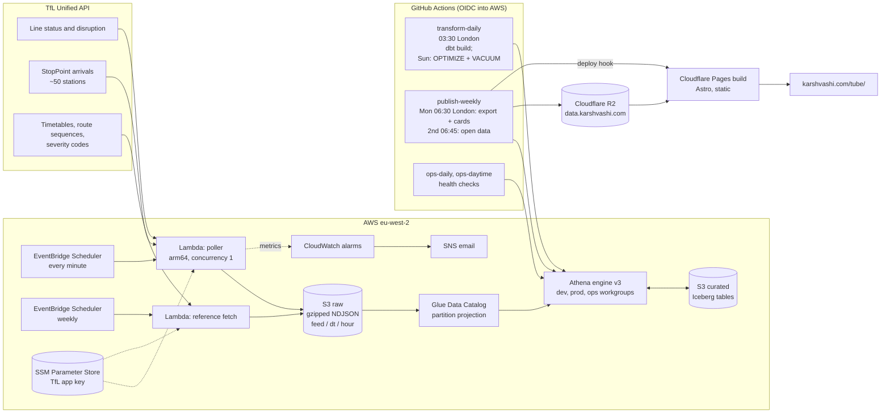

# Architecture

How data gets from TfL's API to the weekly league on karshvashi.com, and who is allowed to do what along the way. The choices behind each piece are in [adr/](adr/); the metric definitions are in [methodology.md](methodology.md).

## Overview

## Data flow

1. **Collect.** EventBridge Scheduler invokes the poller Lambda every minute. It calls TfL for line status, line disruption and the Arrivals board of every measurement station (about 52 calls, bounded concurrency, finished in seconds), and writes each feed's responses as one gzipped NDJSON object to the raw bucket under `raw/{feed}/dt=YYYY-MM-DD/hour=HH/`. Each line is an envelope with the poll id, UTC poll time, request, HTTP status, latency and TfL's payload unchanged. Failed calls are written too, so missing data is visible (ADR-003). The poller runs with reserved concurrency 1, so polls never overlap (ADR-006). A second Lambda fetches timetables, route sequences and severity codes weekly (ADR-007). Both read the TfL app key from SSM at cold start.
2. **Catalogue.** Glue tables with partition projection expose the raw prefixes to Athena. There are no crawlers: partitions resolve from the path.
3. **Transform.** `transform-daily.yml` runs `dbt build --target prod` at 03:30 London time with `dbt-athena`. Staging models flatten, type and deduplicate the raw envelopes into Iceberg tables, merging whole days on a row key (ADR-008). Intermediate models compute the status of every line-minute, incidents, inferred arrivals and headways; they rebuild in full from the seeds each run, so a definition change applies to all history at once (ADR-012, proposed). Marts hold daily and weekly scores per line. Tests (generic, singular and unit tests against hand-computed cases) run in the same build. Raw is kept indefinitely; everything downstream can be rebuilt from it, and a manual run can full-refresh named models from raw as the same role (runbook, "Full refresh in prod"). On Sundays the run ends with `dbt run-operation iceberg_maintenance`: `OPTIMIZE` and `VACUUM` on the incremental staging tables, the only ones that persist between runs (D64).
4. **Export.** `publish-weekly.yml` runs on Mondays at 06:30 London time. It reads the marts through Athena, builds every JSON file in the published contract (`src/mind_the_data/publish/contract/`), validates each against its JSON Schema, and renders the share cards from an HTML template in headless Chromium.
5. **Publish.** The same job uploads the files to a Cloudflare R2 bucket served at `data.karshvashi.com`, with per-file content types and cache headers, `league/latest.json` and `meta/index.json` last. It then calls the Cloudflare Pages deploy hook.
6. **Open data.** On the 2nd of each month the same workflow exports the previous London month as Parquet: Athena `UNLOAD`s each dataset into the prod workgroup's results prefix, the job downloads and checks the files, writes a README (attribution, licence, columns) and a manifest with checksums, and uploads them to `open-data/{yyyy-mm}/` in R2 without a site rebuild (runbook, "Monthly open data"; D63).
7. **Site.** The website (its own repository) fetches `meta/index.json` and the files it lists at build time, validates them, and renders static pages. If anything fails, Pages keeps serving the previous build ([site-integration.md](site-integration.md)).

`dev` and `prod` dbt targets write to separate Glue databases and S3 prefixes, both reading the same raw data. Each target has its own Athena workgroup with an enforced per-query scan cap; the ops workgroup for health checks has a lower one.

## Monitoring

- **CloudWatch alarms** to SNS email: poller error rate, poller throttles, no objects written per feed for 10 minutes, and TfL request failures.
- **ops-daily** reports the previous UTC day's completeness, alarm history, Lambda errors and raw freshness, and keeps one open GitHub issue while anything misses its target. **ops-daytime** checks at midday on weekdays that every configured line shows predictions at its stations in the stored arrivals.
- `make status` gives the same picture from a laptop, read-only.

## Security model

The design goal: nothing that runs unattended, and nothing a pull request can change, can widen its own access.

### No long-lived AWS keys in CI

Every workflow gets short-lived credentials through GitHub's OIDC provider. Each role's trust policy checks two claims of the job's token:

- **`sub`:** the repository by its immutable id, not its name, so a rename or transfer cannot inherit the trust (ADR-009), plus the branch: `pull_request` for plans, `refs/heads/main` for everything else.
- **`job_workflow_ref`:** the exact workflow file, so a new workflow on `main` cannot borrow another workflow's role (ADR-010).

| Role | Trusted from | Can do |
| --- | --- | --- |
| `mtd-ci-plan` | `infra.yml`, `bootstrap-plan.yml` on pull requests; `bootstrap-plan.yml` on `main` | read-only Terraform plan |
| `mtd-ci-apply` | `infra.yml` on `main` | deploy `infra/envs/prod` |
| `mtd-ci-transform` | `transform-daily.yml` on `main` | Athena, Glue and S3 for the prod dbt target; no writes to raw |
| `mtd-ci-observer` | `ops-daily.yml`, `ops-daytime.yml` on `main` | read-only, queries in the ops workgroup |
| `mtd-ci-publish` | `publish-weekly.yml` on `main` | read the prod marts, write only Athena query results (including the open data's `UNLOAD` output) |

A job that names a GitHub environment gets a different subject and is refused, so no workflow can route around the branch rule.

### The pipeline cannot change its own access

- The CI roles and the boundary policy are defined in `infra/modules/ci_role` and applied only from `infra/bootstrap`, by a person, as an MFA-protected admin identity (ADR-005). They are named `mtd-*`, outside the `mind-the-data-*` prefix the deploy role may manage.
- **Permissions boundary.** Every IAM role the pipeline creates (the Lambda roles) must carry `mtd-workload-boundary`. It allows reading and writing project buckets in this account, writing the project's log groups and metrics in the project namespace, reading the project's SSM parameters (with KMS decrypt through SSM), publishing to project SNS topics and invoking project Lambda functions, and nothing else. The deploy role cannot create a role without it, remove it, or publish a new version of it.
- The deploy role cannot delete buckets or object versions, change versioning, set ACLs, delete raw objects, create Lambda function URLs or add resource policies to functions. The account-level S3 public access block, which CI cannot change, is the control for public access.

### Merging is the approval

- Pull requests only plan. The plan is reviewed on the pull request; merging to `main` deploys it (ADR-005). Deletes need an explicit marker.
- `main` requires a pull request and the `ci` check, and refuses force pushes.
- **Merge gate (ADR-011, accepted).** Low-risk pull requests may be merged by the project's engineer through `make merge`, and only when a gate allows it. The gate always runs `main`'s copy of its code and policy, so a branch cannot loosen it. It refuses any change to protected paths (the bootstrap, the CI role module, `.github/`, ADRs, the gate itself), any IAM change, delete, replace or import in the pull request's own CI plan, and any resource type not on its allowlist. Everything else waits for the owner.

### Secrets

- The **TfL app key** is a SecureString in SSM. Lambdas read it at runtime; Terraform refers to it by ARN only, so it never lands in state that plan jobs can read. It is stripped from recorded test fixtures, and a pre-commit hook refuses it in committed files.
- The **R2 token** (object read and write on one bucket) and the **Pages deploy hook URL** are GitHub secrets. Only the upload step of `publish-weekly.yml` receives their values, with the job's AWS session removed from its environment first; the gate job sees only whether each one is set. The code never prints them, including in errors.
- The local **dev identity** is read-only, plus Athena queries in the dev workgroup.

### Cost guards

Every Athena workgroup enforces a per-query scan cap that clients cannot lift. Lambdas run outside a VPC, so there is no NAT gateway. An AWS Budget on the project's tagged spend (6.50 USD, about £5 a month) alerts at 50%, 80% and 100%. Actual spend is in [cost.md](cost.md).

## Repository map

| Path | Contents |
| --- | --- |
| `src/mind_the_data/ingest/` | poller and reference Lambdas, TfL client, Pydantic models, raw writer |
| `src/mind_the_data/analysis/` | Python reference implementation of arrival inference (the SQL's test oracle) |
| `src/mind_the_data/publish/` | export, JSON contract, share cards, monthly open data, R2 upload |
| `src/mind_the_data/ops/` | health checks, status report, merge gate |
| `transform/` | dbt project: seeds, staging, intermediate, marts, tests |
| `infra/bootstrap/` | state bucket, CI roles, permissions boundary (human-applied) |
| `infra/envs/prod/`, `infra/modules/` | everything else, deployed by `infra.yml` |
| `.github/workflows/` | `ci`, `infra`, `transform-daily`, `publish-weekly`, `ops-daily`, `ops-daytime`, `bootstrap-plan` |
